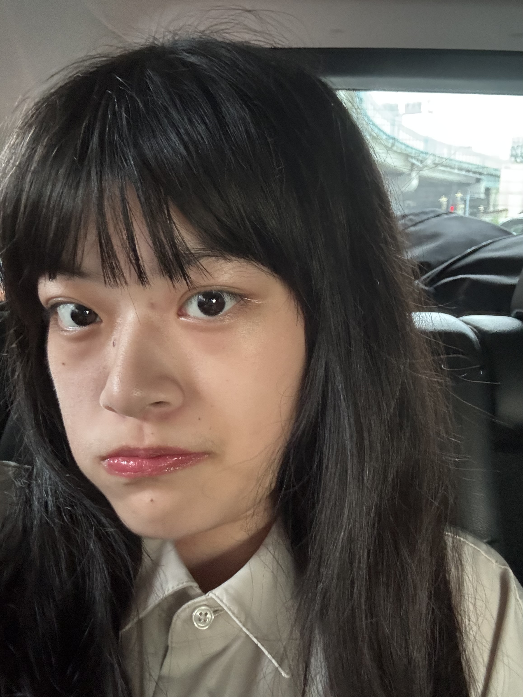
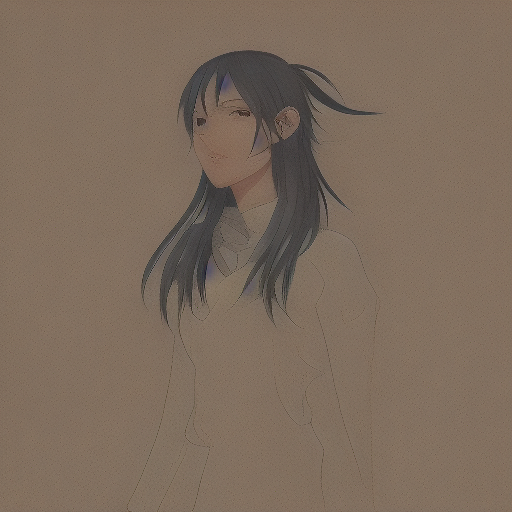
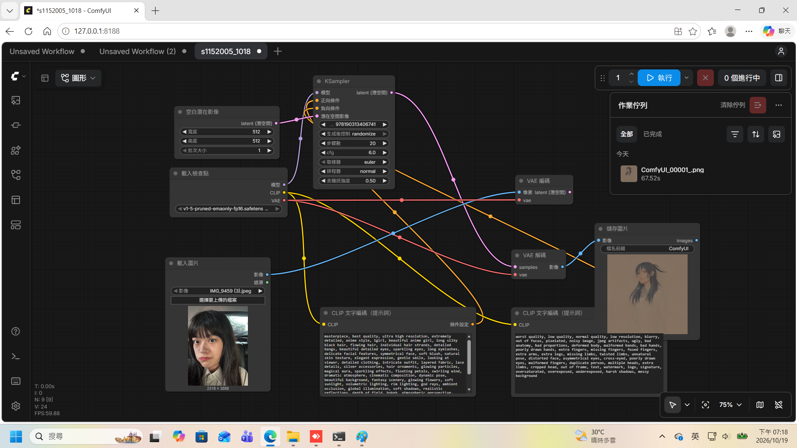

## 原圖 
  
 ## 生成圖
   
 ## 完整工作流截圖
    
 ### 正提示詞
 ####  masterpiece, best quality, ultra high resolution, extremely detailed, anime style, 1girl, beautiful anime girl, long silky black hair, flowing hair, individual hair strands, detailed bangs, beautiful detailed eyes, sparkling eyes, long eyelashes, delicate facial features, symmetrical face, soft blush, natural skin texture, elegant expression, gentle smile, looking at viewer, detailed clothing, intricate outfit, layered fabric, lace details, silver accessories, hair ornaments, glowing particles, magical aura, sparkling effects, floating petals, swirling wind, dramatic atmosphere, cinematic composition, dynamic pose, beautiful background, fantasy scenery, glowing flowers, soft sunlight, volumetric lighting, rim lighting, god rays, ambient occlusion, global illumination, soft shadows, realistic reflections, depth of field, bokeh, atmospheric perspective, color harmony, vibrant colors, rich details, sharp focus, finely detailed eyes, detailed hair texture, detailed fabric texture, professional illustration, polished artwork, breathtaking scenery, fantasy art, 
 ### 反提示詞
 #### worst quality, low quality, normal quality, low resolution, blurry, out of focus, pixelated, noisy image, jpeg artifacts, ugly, bad anatomy, bad proportions, deformed body, malformed hands, bad hands, poorly drawn hands, extra fingers, missing fingers, fused fingers, extra arms, extra legs, missing limbs, twisted limbs, unnatural pose, distorted face, asymmetrical eyes, cross-eyed, poorly drawn eyes, malformed fingers, duplicate person, multiple heads, extra limbs, cropped head, out of frame, text, watermark, logo, signature, oversaturated, overexposed, underexposed, harsh shadows, messy background
 ## 心得
 #### 一開始寫完所有節點之後發現少了模型未加入,之後又因為照片解析度太高無法生成照片,所以在pytorch的命令列裡找到記憶體崩潰的問題,因此又加了一個節點去調整照片的長寬就成功了